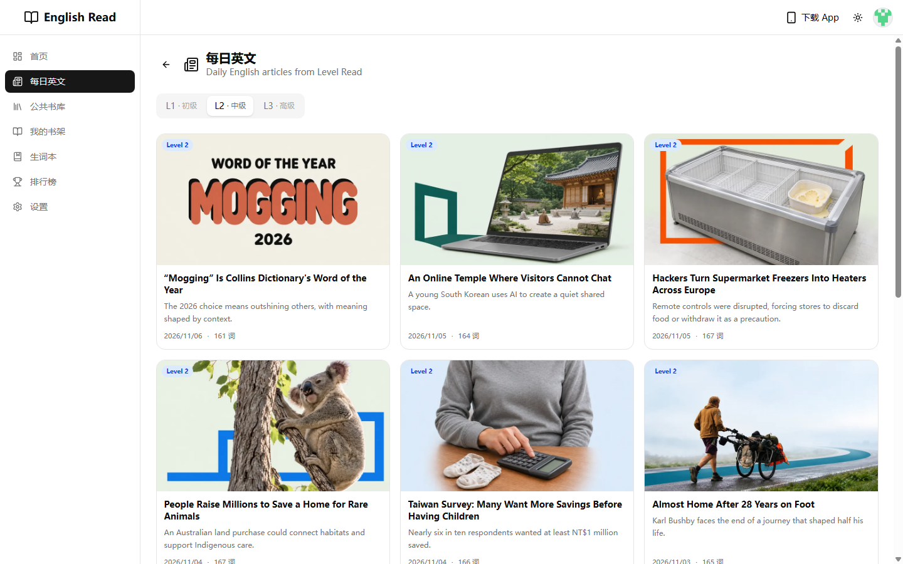
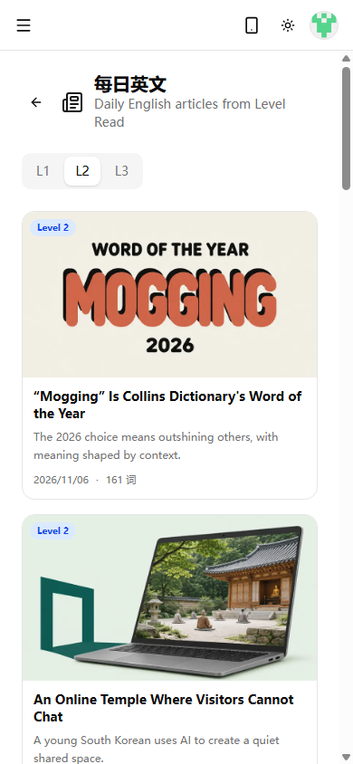
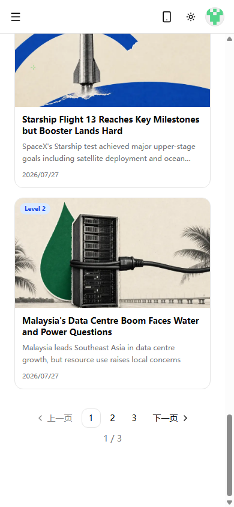
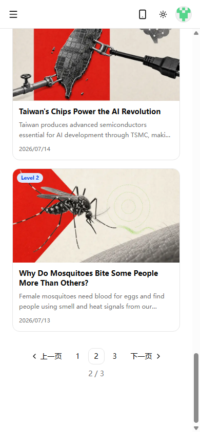
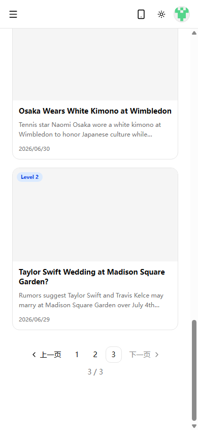
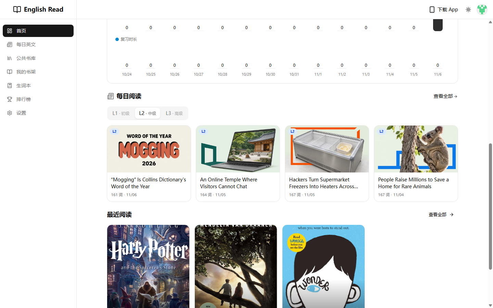

# 文章列表排序与分页测试报告

- 测试日期：2026-11-06
- 被测对象与版本：english-read 当前 `preview` 工作区改动（未提交）；`/articles`、`/dashboard`
- 运行环境：Windows；Chrome 156；本地生产模式服务 `http://localhost:5000`；视口分别为 1440×900 和 390×844；使用 `.env.local` 数据
- 被测逻辑：Level 2 文章列表和首页每日文章区按发布日期倒序展示；文章列表分页在桌面和 390px 移动视口下可读、可操作且无横向溢出。
- 截图说明：均为 Playwright 页面视口截图；分页截图滚动到了页面底部，原图保存在同目录 `截图/`。
- 原始证据：`playwright-文章排序分页验证.log`

## 测试结果

测试期间仅浏览页面，没有新增、编辑或删除数据库记录。分页交互通过实际点击“下一页”后核对 URL、当前页状态及页面内容；测试结果以浏览器实际读数和截图为准。

| 序号 | 测试类型 | 测试项 | 测试输入（执行的命令） | 测试结果 | 是否符合预期 | 截图 |
| --- | --- | --- | --- | --- | --- | --- |
| 1 | 桌面正常路径 | `/articles` 最新文章及第一页布局 | `page.setViewportSize({width:1440,height:900})`；`page.goto('http://localhost:5000/articles?level=2&page=1')` | 显示 12 篇文章，首篇为 `“Mogging” Is Collins Dictionary's Word of the Year`，日期 `2026/11/06`；当前页为 1；文档宽度与视口均为 1440px。 | 是 |  |
| 2 | 移动端响应式 | 390px 视口文章卡片与横向溢出 | `page.setViewportSize({width:390,height:844})`；`page.goto('http://localhost:5000/articles?level=2&page=1')` | 页面显示 12 篇文章，最新的 `Mogging` 排首位；`document.scrollWidth=390`、`main.scrollWidth=375`，未出现横向溢出。 | 是 |  |
| 3 | 移动端分页 | 首页页码组件宽度、当前页展示 | 在第 1 页执行 `document.querySelector('[data-slot="pagination"]').scrollIntoView({block:'center'})` | 分页栏宽 327px（视口 390px），内容为“上一页、1、2、3、下一页”，页码状态显示 `1 / 3`；截图中控件完整可见。 | 是 |  |
| 4 | 移动端交互 | 点击“下一页”进入第 2 页 | `page.locator('[data-slot="pagination"] a[aria-label="下一页"]').click({force:true})`；随后读取 URL 和 `[aria-current="page"]` | URL 到达 `/articles?level=2&page=2`，当前页高亮为 2，分页状态 `2 / 3`；分页栏仍在 390px 视口内。Playwright 的 `waitForURL` 等待整页 `load` 超时，但后续页面 URL、DOM 和截图均确认客户端导航已完成。 | 是 |  |
| 5 | 移动端边界 | 末页不再提供“下一页”链接 | `page.goto('http://localhost:5000/articles?level=2&page=3')`；滚动分页到视口并检查 `[aria-disabled="true"]`、`[aria-current="page"]` | 当前页为 3，页码状态 `3 / 3`；“下一页”是禁用状态且 `tabIndex=-1`，不再有可点击的下一页链接；文档宽度仍为 390px。 | 是 |  |
| 6 | 首页排序 | `/dashboard` 每日阅读文章排序 | `page.goto('http://localhost:5000/dashboard')`；读取 `a[href^="/articles/"]` 前 4 项 | 每日文章区前四项日期依次为 `11/06`、`11/05`、`11/05`、`11/04`；第一项为 `Mogging`。 | 是 |  |

## 收尾状态

- 测试前：工作区位于 `preview` 分支，文章列表、首页排序和分页组件已有未提交改动；`docs/notion/` 是原有未跟踪目录。
- 测试中改动：只新增测试报告、日志和截图；浏览页面为只读，没有改动数据库数据。
- 收尾：已停止本轮沿用的本地 `next start -p 5000` 服务，并确认 5000 端口无监听；`npm run build` 通过（编译、Lint/类型检查及 67 个静态页面生成完成）。
- 无法恢复项：无。
- 结论：桌面排序、首页排序、390px 移动端列表布局、分页显示/切换和末页边界均通过。
- 范围限制：仅使用当前本地数据库数据验证，未验证线上生产数据；移动端文章列表检查视口为 390×844，未覆盖 320px 等更窄设备；首页移动端样式未验证（本次移动端打开首页时内容停留在“加载中…”占位状态）；本地控制台出现 `_vercel/insights/script.js` 404（本地非 Vercel 运行环境资源），与文章列表及分页交互无关。
